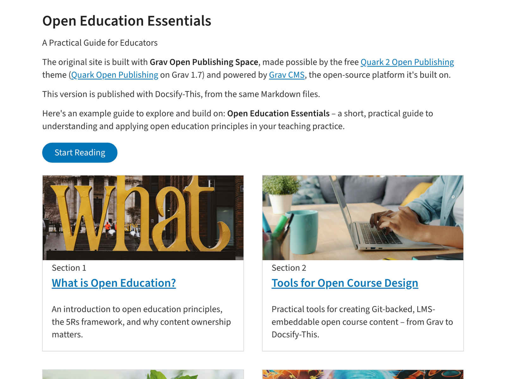

# Docsify-This Guide Site Template

> This is a guide site template for use with [Docsify-This.net](https://docsify-this.net/#/). Its example guide, **Open Education Essentials**, comes from [Grav Open Publishing Space](https://github.com/hibbitts-design/grav-skeleton-open-publishing-space), published from the same Markdown files. For a site with more than one guide, see the [Docsify-This Multiple Guides Site Template](https://github.com/hibbitts-design/docsify-this-multiple-guides-site).

_Figure 1. Docsify-This Guide Site Template. Explore the resulting standalone web site generated by Docsify-This.net at [https://docsify-this.net/?basePath=https://raw.githubusercontent.com/hibbitts-design/docsify-this-guide-site/main&homepage=home.md&sidebar=true&loadSidebar=_sidebar.md&collapsibleSidebarGroups=true&name=Open%20Education%20Essentials&dark-mode=auto&pagination=true&searchbox=true](https://docsify-this.net/?basePath=https://raw.githubusercontent.com/hibbitts-design/docsify-this-guide-site/main&homepage=home.md&sidebar=true&loadSidebar=_sidebar.md&collapsibleSidebarGroups=true&name=Open%20Education%20Essentials&dark-mode=auto&pagination=true&searchbox=true)_

How to Use
---

1. Sign in to [GitHub](https://github.com), or create an account if you don’t already have one.

2. Tap **Use this template** in this repository (upper-right green button) and then choose **Create a new repository**

3. Choose the name for your new repository to contain the files and then tap **Create repository from template**

4. View an included Markdown file, for example **home.md**, and copy its URL.

5. Go to https://docsify-this.net and paste the copied URL into the **Markdown File URL** field

6. Select the page options you want (e.g. Docsify Sidebar) and tap the **Publish as a Web Page** button to view your Markdown file as a web page for sharing or embedding

> [!NOTE]
> For this template to work as designed, choose **Sidebar** for page layout and, in the **Advanced Web Page Builder Options** section, load the Docsify custom **Sidebar** file, which sets the guide's reading order, and enter the guide's name in **Website name displayed in Sidebar** (it links back to the home page from every page).

To edit a file in GitHub, tap the **Pencil icon** (Edit this file) in the upper-right when viewing the file, make your changes, and then tap the **Commit changes...** button to save those changes.  

To load the provided [Docsify custom sidebar](https://docsify.js.org/#/more-pages?id=sidebar), with collapsible sidebar groups, manually add `&loadSidebar=_sidebar.md&collapsibleSidebarGroups=true` and your guide's name, such as `&name=Open%20Education%20Essentials`, to your published Docsify-This URL, for example:
https://docsify-this.net/?basePath=https://raw.githubusercontent.com/hibbitts-design/docsify-this-guide-site/main&homepage=home.md&sidebar=true&loadSidebar=_sidebar.md&collapsibleSidebarGroups=true&name=Open%20Education%20Essentials&dark-mode=auto

Using the ability to change the default values of the Docsify-This Web Page Builder, here are the needed **Sidebar**, **collapsible Sidebar groups**, **Previous/Next page buttons**, **Search** and **Website name** options already set - just replace the default Markdown file URL for **home.md** with your own! https://docsify-this.net/?advanced=true&url-field=https://github.com/hibbitts-design/docsify-this-guide-site/blob/main/home.md&sidebar=true&loadSidebar=true&collapsibleSidebarGroups=true&pagination=true&searchbox=true&name=Open%20Education%20Essentials&dark-mode=auto

> [!IMPORTANT]
> To add an edit link, set `edit-link` to your repository (for example `&edit-link=https://github.com/your-name/your-repo`), not to a Markdown file – with a Markdown file, links between the pages stop working.

Edit the Guide
---

- `home.md` – the guide's home page, with a card for each section
- a folder per section, with its `README.md` (the section's first page) and its other pages
- `_sidebar.md` – the reading order, with collapsible section groups (Previous/Next follows it)

The guide follows a simple pattern – keep it as you add sections and pages:

- `_sidebar.md` lists only the reading order: the sections and their pages, not the home page
- The site's name (the `name` option) is the guide's name, and links back to the home page from the top of the sidebar
- The home page hides the sidebar, with the `<style>` line (and the comment above it) at the end of the file – copy it to any other page that isn't part of the reading order

> [!TIP]
> Images go in the same folder as the page that shows them.

Docsify-This Examples
---

Guide Site [home.md](https://github.com/hibbitts-design/docsify-this-guide-site/blob/main/home.md) file displayed by Docsify-This as: 
* [Standalone Site with a Docsify Sidebar, and Search](https://docsify-this.net/?basePath=https://raw.githubusercontent.com/hibbitts-design/docsify-this-guide-site/main&homepage=home.md&sidebar=true&loadSidebar=_sidebar.md&collapsibleSidebarGroups=true&name=Open%20Education%20Essentials&dark-mode=auto&searchbox=true "Docsify-This Guide Site - Standalone Site with a Docsify Sidebar, and Search")  
* [Standalone Site with a Docsify Sidebar, Pagination buttons and Search](https://docsify-this.net/?basePath=https://raw.githubusercontent.com/hibbitts-design/docsify-this-guide-site/main&homepage=home.md&sidebar=true&loadSidebar=_sidebar.md&collapsibleSidebarGroups=true&name=Open%20Education%20Essentials&dark-mode=auto&pagination=true&searchbox=true "Docsify-This Guide Site - Standalone Site with Pagination buttons and Search")  
* [Standalone Site with a Docsify Sidebar, Pagination buttons, Search and initially collapsed Sidebar groups](https://docsify-this.net/?basePath=https://raw.githubusercontent.com/hibbitts-design/docsify-this-guide-site/main&homepage=home.md&sidebar=true&loadSidebar=_sidebar.md&collapsibleSidebarGroups=true&name=Open%20Education%20Essentials&dark-mode=auto&pagination=true&searchbox=true&collapseSidebarGroups=true "Docsify-This Guide Site - Standalone Site with Pagination buttons, Search and initially collapsed Sidebar groups")  
* [Standalone Site with a Docsify Sidebar, Pagination buttons, Search and a 'Source Markdown Files' link](https://docsify-this.net/?basePath=https://raw.githubusercontent.com/hibbitts-design/docsify-this-guide-site/main&homepage=home.md&sidebar=true&loadSidebar=_sidebar.md&collapsibleSidebarGroups=true&name=Open%20Education%20Essentials&dark-mode=auto&pagination=true&searchbox=true&edit-link=https://github.com/hibbitts-design/docsify-this-guide-site&edit-link-text=Source%20Markdown%20Files&edit-link-emoji=:file_folder: "Docsify-This Guide Site - Standalone Site with Pagination buttons, Search and a 'Source Markdown Files' link")

The guide's content is licensed [CC BY 4.0](https://creativecommons.org/licenses/by/4.0/) – copy it, adapt it and share it, with credit.
